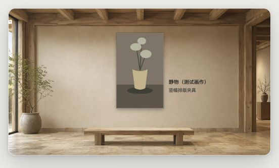

# 艺息 ArtBreeze

等一段回答，看一幅画。Chrome Manifest V3 扩展，当前版本 **1.1.0**。

在支持的 AI 网页中按 Enter，ArtBreeze 展示一幅画，约 20 秒后收起；也可以点击右下角入口手动打开，通过展厅右上角的收起按钮或点击外部关闭。



## 这次更新

- **24 个 ArtDuo 展厅**随扩展打包，图片合计 886,902 字节（约 866 KiB），背景不依赖网络服务。
- 默认开启展厅；按画作的配色、比例与稳定标识匹配，也可固定任意场景。悬停、重新打开同一幅画或切换光线不会重新随机。
- 画作完整显示并保持水平居中，作品名称与作者独立放在右侧；小窗口收为底部短说明。
- 支持白天、夜间、跟随系统，以及三种展厅大小。夜间只调节环境光，不给原画加滤镜。
- 保留原有启用开关、作品信息、Enter 触发、手动打开、缓存与预加载；升级不会重置旧设置。
- 工具在悬停或键盘焦点进入展厅时显示；收起按钮支持键盘，焦点在展厅内时可按 Esc。
- 关闭场景或背景加载失败时，画作仍可在素色界面中显示；支持减少动态效果。

展厅由本地 WebP、挂画区域与配色元数据组成。作品内容继续使用原有 Google Arts & Culture 数据源；背景离线可用不代表首次加载作品无需联网。

## 安装

1. 克隆仓库，或将生成的发布 ZIP 解压到独立目录。
2. 在 Chrome 的扩展程序页面开启“开发者模式”。
3. 选择“加载已解压的扩展程序”，选中包含 `manifest.json` 的目录。
4. 打开支持的 AI 网页；更新后重新加载扩展和网页。

支持 ChatGPT、Claude、Gemini、Copilot / Bing、Kimi、Grok、DeepSeek、元宝、豆包等。注入范围由 `manifest.json` 中的 AI 站点清单限定，不再注入所有网页。具体站点 DOM 变化仍可能影响原有 Enter 识别。

此浏览器扩展沿用网页 Enter 触发和定时收起，不接入 InIsle 的 CLI Hook，也不将定时器视为模型真实完成信号。

## 设置

点击浏览器工具栏中的 ArtBreeze 图标：

| 设置 | 行为 |
| --- | --- |
| 启用艺息 | 控制入口与等待展示 |
| 显示作品信息 | 控制标题、来源链接与作者 |
| 展厅背景 | 展厅或原有素色界面 |
| 场景 | 自动匹配，或固定 24 个展厅之一 |
| 光线 | 跟随系统 / 白天 / 夜间 |
| 展厅大小 | 小 / 中 / 大；自动适应可用窗口 |

来源链接只接受 HTTP(S)，新标签打开时不把页面控制权交给来源网站。

## 开发与打包

需要 Node.js 18+ 和 Python 3；日常开发不需要安装 npm 依赖。

```bash
npm run check
npm run preview
npm run build
```

- `check`：JavaScript 语法、场景哈希、匹配、居中布局、升级迁移与异步关闭回归。
- `preview`：打开终端打印的本地地址。运行真实展示代码，使用模拟 Chrome API、测试画作及网络内容；不安装扩展，不读取真实聊天。
- `build`：检查通过后生成 `dist/artbreeze-1.1.0.zip`。仅打包运行文件、图标、场景和隐私说明，排除测试、截图、Git 与开发脚本。

发布 ZIP 已可供人工加载检查；本轮未向 Chrome 商店提交。上架仍需商店账号、素材权利确认、商店截图和隐私披露，参见 [验证与发布说明](docs/2026-10-27-gallery-verification.md)。

## 场景维护

`gallery/` 是 ArtBreeze 与 [WaitWiki](https://github.com/astroleno/WaitWiki) 共用的、带版本的本地资源模块。ArtBreeze 维护主副本，WaitWiki 同步完整副本；两个产品可独立打包，不在运行时互相依赖。

从本地 ArtDuo 重新制备素材时需要 Pillow 和 cwebp：

```bash
python3 scripts/prepare-gallery.py --artduo /path/to/ArtDuo
python3 scripts/sync-gallery.py --from ./gallery --to /path/to/WaitWiki/gallery
```

24 个稳定场景 ID、原图来源、压缩后哈希、挂画区域和展签明暗均记录在 `gallery/scenes.json`。请同步整个模块并在两边运行检查，避免图片与配置版本错配。

[模块设计](docs/gallery-design.md) · [素材来源](gallery/SOURCES.md) · [隐私说明](privacy.md)

## 致谢与许可

感谢 [Artab](https://github.com/get-artab/artab)、[Google Arts & Culture](https://artsandculture.google.com/) 和 ArtDuo 的内容与设计参考。代码沿用原项目的 MIT 许可声明；作品与场景图片的权利不因代码许可自动转移，见素材来源说明。
