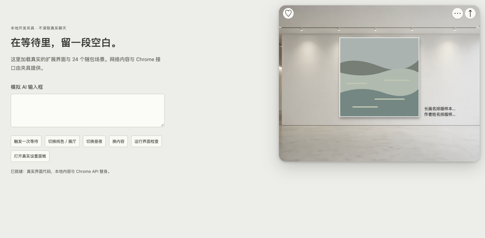
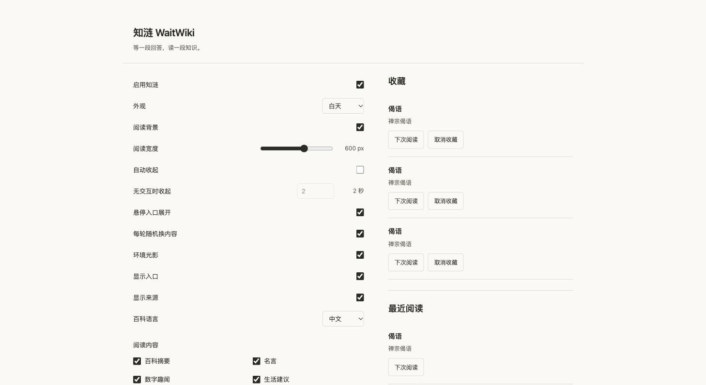

# ArtBreeze / WaitWiki：问题复现与严重度复核

日期：2026-10-28。对应版本：ArtBreeze 1.2.0、WaitWiki 1.4.0；源码仍为 `e9907f5` / `f80ddb1`。本次按用户反馈复核原审阅的 R1–R8，未修改产品代码。

## 复核结论

本次核实的项目中，没有发现必须紧急处理的 P1 阻断。上次对键盘路径的判断偏重：问题存在，但可用 Shift+Tab 进入面板，鼠标路径、自动展示保留输入焦点、面板内焦点保持均正常，因此降为 **P2（中等）**。这不是对全部站点、原生扩展或所有功能无故障的保证。

用户已明确“两款本来就是一个系列，重叠没问题”。**R2 从缺陷和整改清单移除**，保留现有系列布局，不再要求互斥、避让或另行确认共存方案。

| 项目 | 能否复现 | 重新定级 | 实际影响 |
| --- | --- | --- | --- |
| R1 键盘从入口打开后焦点落空 | 两款均复现；Enter 后 BODY 获得焦点，直接 Esc 无效；向前 Tab 离开面板 | P2，中等，优先改 | 全键盘用户需要反向 Tab 才能进入。Shift+Tab 后面板保持，Esc 能收起并返回入口；鼠标操作正常 |
| R2 两款重叠 | 已有几何证据，本次不再测试 | 已接受设计，不是缺陷 | 用户已确认系列产品允许重叠 |
| R3 换内容时整面消失 | 两款均复现；0 / 200 / 1000 / 8000ms 受控延迟各一组 | P2，中等，来源慢时明显 | 快速响应仅隐藏约 2–3ms；慢响应时整个空间随请求消失，缺少就地反馈。返回后可继续使用 |
| R4 Art 长画名、作者截断 | 360 / 600 / 800px 面板均复现；悬停、聚焦仍为省略号 | P3，轻微 | 不影响看画；影响就地辨认作品。完整文字仍在 DOM/图像 alt，画名也保留来源链接 |
| R5 Wiki 同名收藏无法区分 | 使用仓库实际三条“偈语 / 禅宗偈语”复现；三行显示文字完全一样 | P2，中等 | 随机阅读不受影响；想回到指定收藏时需要猜选，实际查找成本高 |
| R6 默认 2 秒、九类随机 | 2 秒规则已验证；未做用户阅读速度研究 | 已确认设计，非实现错误 | 面板内悬停或聚焦超过 2.3 秒仍保持；不据主观阅读偏好改默认值 |
| R7 设置分组、Art“阅读”文案 | 源码和设置界面可见 | P3，可选整理 | 可理解性与一致性优化，不阻断当前操作 |
| R8 动效策略 | 每款快速开关 6 次均保持正确结束状态；减少动效时动画数为 0 | 可选优化，未复现功能性异常 | 未做帧率测试，也没有据此确认“卡顿”或“明显破坏心流” |

建议下一版先处理 R1、R3，再改善 R5。R4、R7 可随界面整理处理；R6 保持已有设计，R8 需要有明确体验收益再改。本次结果不构成撤回当前送审版本的充分理由；本轮未操作商店后台。

## 方法与证据边界

- 使用现有 `scripts/serve-preview.py`，两款分别运行在独立本地端口，通过 ego-browser 的 Chromium 进行真实按键、鼠标悬停和菜单点击。
- 使用未修改的生产 Companion、Session、Stage、Settings 和 options 渲染代码；Chrome API、存储和公开内容请求使用项目已有开发替身。
- 仅在测试页内存中设置偏好、添加请求延迟及观察记录；没有安装到用户的日常 Chrome，也没有发送真实 AI 消息、调用在线内容源或变更真实收藏。
- 共记录 **24 项交互/动效观察、8 组请求延迟、3 个画廊宽度、1 组包含 3 条实际内容的收藏列表**。不将这些观察称为原生扩展全量测试或性能基准。
- 原始结果：[severity-recheck.json](assets/2026-10-28-severity-recheck.json)。上一轮独立审阅仍保留为历史判断，以本次复核与用户确认后的定级为准。

## 复现步骤及反例

### R1：键盘入口焦点

1. 运行对应开发预览，启用生产默认的“自动收起 / 2 秒”。为隔离鼠标误触，测试中关闭入口悬停展开，并将指针移到面板之外。
2. 聚焦“艺 / 知”入口，按 Enter。
3. 两款的 `activeElement` 均落到 BODY，`focusInside=false`，`interacting=false`；直接按 Esc 不收起，随后自动收起。
4. 重新从入口 Enter 后按 Tab：焦点移到面板之外。本地页的落点是浏览器辅助按钮；真实站点的后续 Tab 顺序可能不同，不能把这个具体落点推广到所有站点。
5. 重新 Enter 后按 Shift+Tab：焦点进入面板的“收起”按钮，`interacting=true`；超过 2.3 秒仍展开，Esc 正常收起并将焦点返回入口。

对照：在模拟 AI 输入框按 Enter 自动展示时，两款都保留输入框焦点；鼠标进入面板超过 2.3 秒仍保持。问题范围是**主动键盘进入时缺少合适的焦点落点**，不应再概括为整个键盘交互不可用。

后续若修复，应区分用户主动键盘进入与自动展示；自动展示继续保留 AI 输入焦点。

### R3：换内容期间空间消失

在真实“更多操作 → 换一幅 / 换一条”路径，对 `requestContent` 注入可控延迟，记录生产 Session 的 hide 与 show-start 时点：

| 注入内容响应延迟 | Art 面板隐藏间隔 | Wiki 面板隐藏间隔 |
| --- | --- | --- |
| 0ms | 3ms | 2ms |
| 200ms | 202ms | 202ms |
| 1000ms | 1003ms | 1002ms |
| 8000ms | 8005ms | 8003ms |

上述是本地测试响应，**不是公开 API 延迟实测**。Art 的图片解码是另一个阶段，未把它混入整面隐藏间隔。0ms 组仅证明同样发生隐藏/显示操作，不代表用户必然看见闪动。

反例及恢复：两端另以 3000ms 延迟测试“换内容 → 重新点入口 → 收起”。请求结束后均保持收起，当前条目 ID 未被迟到内容替换；未复现迟到结果强行重新弹出的故障。

因此保留 P2：来源慢时反馈不清、打断观看空间，但没有在本组测试中演变为卡死或无法恢复。下一版若改，可保留外层空间并显示轻量等待状态，继续保留现有过期请求保护。

### R4：画名与作者

以明确标注为排版样本的长标题和长作者名，分别设置面板宽度为 360 / 600 / 800px：

- 标题实际可见宽度约 58 / 96 / 100px，文本宽度为 276px。
- 作者文本宽度为 192px；三种宽度均截断。
- 悬停、聚焦不扩展文字，也没有 `title` 提示。完整标题及作者仍在图像 alt，画名仍为来源链接。

这是信息展示的小缺口，不影响画作显示。保留右侧两行墙签设计；后续可以提供按需查看全文的轻量方式。

### R5：同名收藏

使用仓库 `gathas.csv` 中实际存在的三条不同正文，均为“偈语 / 禅宗偈语”。通过现有开发替身存入本地收藏，再由真实 `options.js` 渲染：

- 三条条目 ID 和正文不同。
- 三行可见文字完全相同，均只有“偈语、禅宗偈语、下次阅读、取消收藏”。
- 仓库中满足当前解析条件的 202 条偈语里，有 31 条使用这一标题与来源组合；该问题不依赖人为构造同名条目。
- 本测试验证的是辨认问题，未把开发替身的跨页选择等同于真实扩展完整收藏链路。

同名收藏较多时，这比画名截断更影响明确任务，保留 P2。可在列表加短正文摘录，不需要改动收藏结构或系列概念。

### R6–R8：设计选择与可选打磨

悬停和面板内焦点保持已通过对照，默认 2 秒不是定时器失效。设置分组、动词和随机类别是产品层面的权衡，保持用户已确认的方案。

在减少动效偏好下，两款的动画/过渡均为 none，活动动画数为 0。每款调用现有生产生命周期连续开关 6 次，最终可见性与入口状态均正确、没有捕获到未处理异常。这一检查覆盖结束状态和减少动效，不覆盖帧率、快速操作的主观观感或全部宿主站点。

## 本次变更

更新两仓库的汇总定级并保存本复核报告、JSON 与两张截图。独立审阅初稿保留，增加指向复核结论的说明。未改产品代码、未提交推送、未操作送审或发布。
